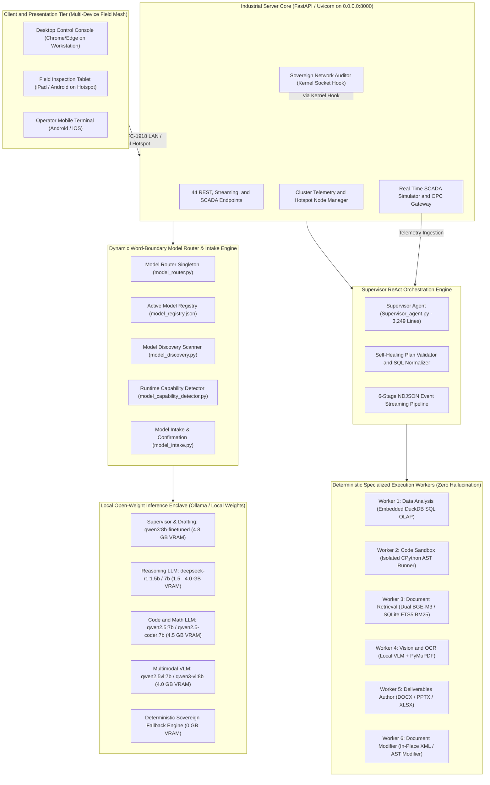
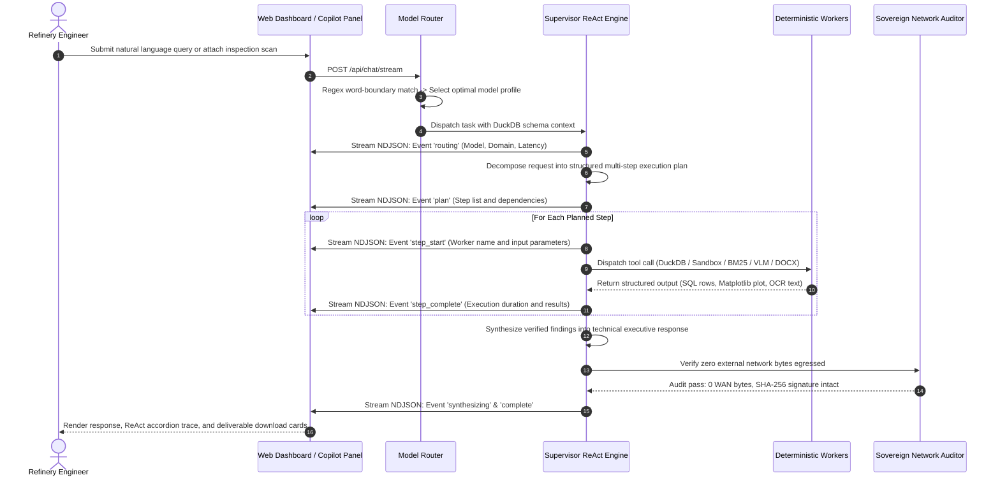
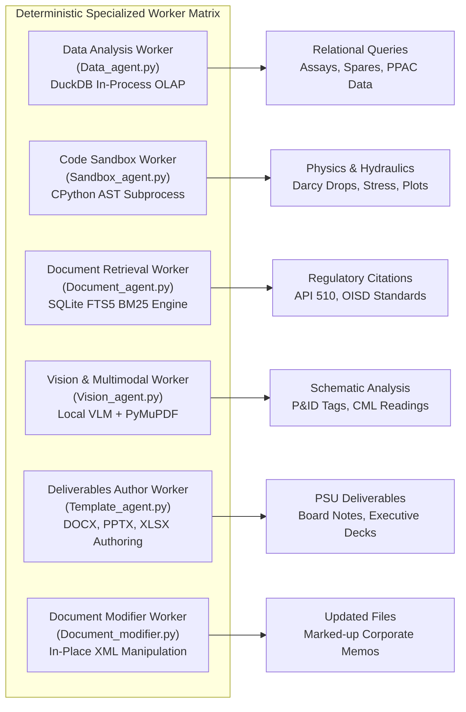
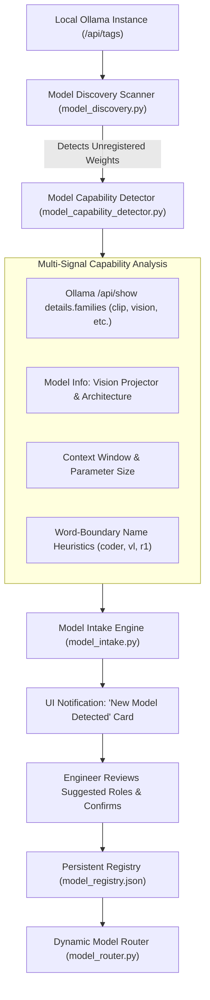
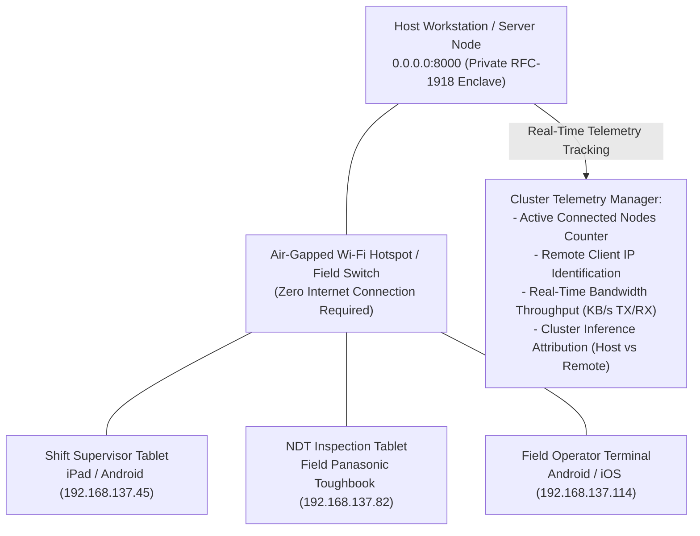
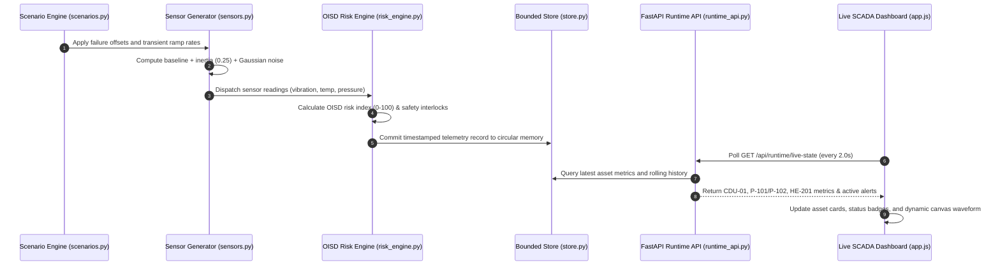
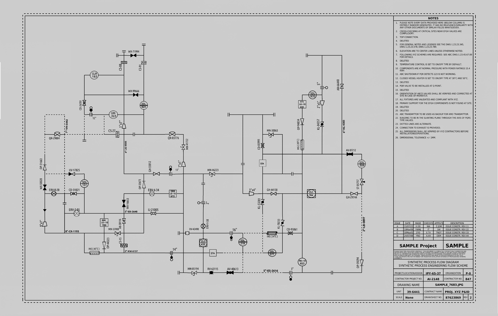
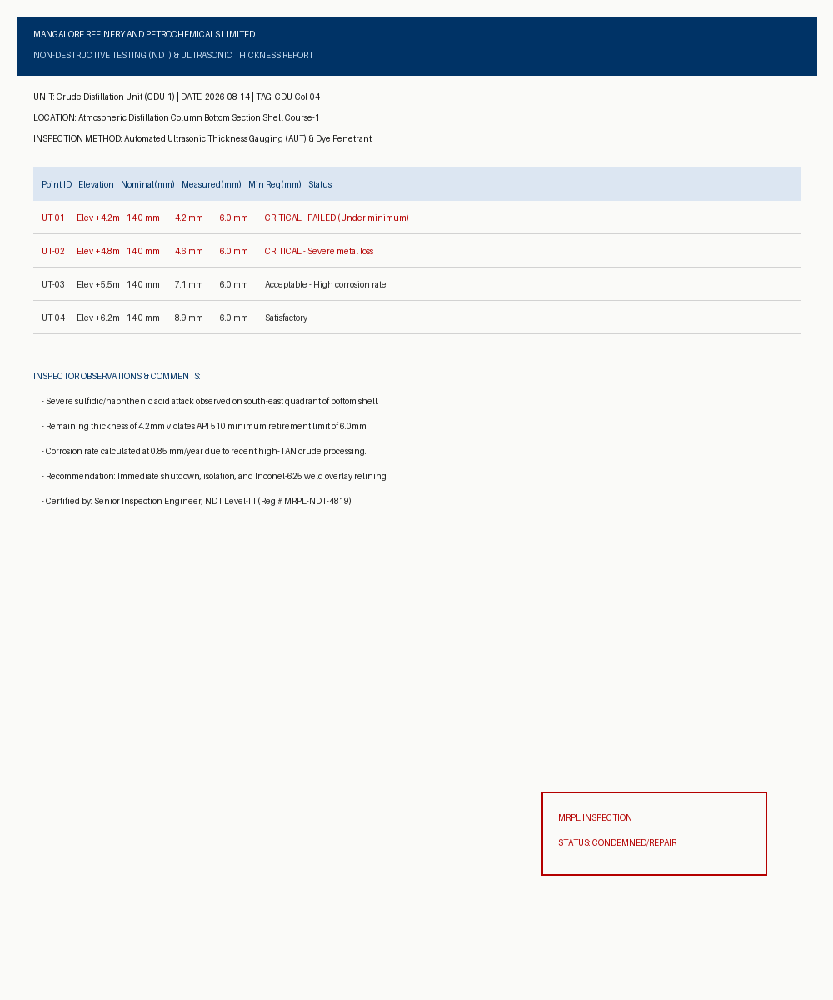
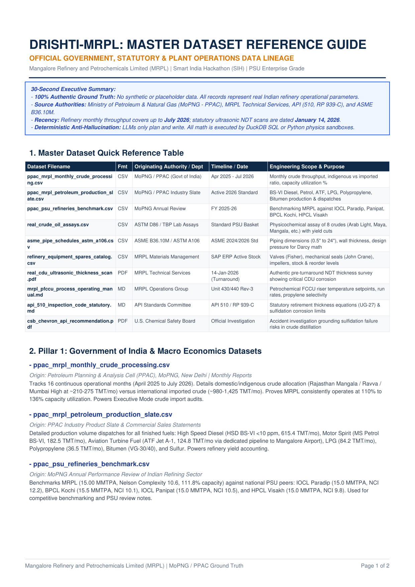
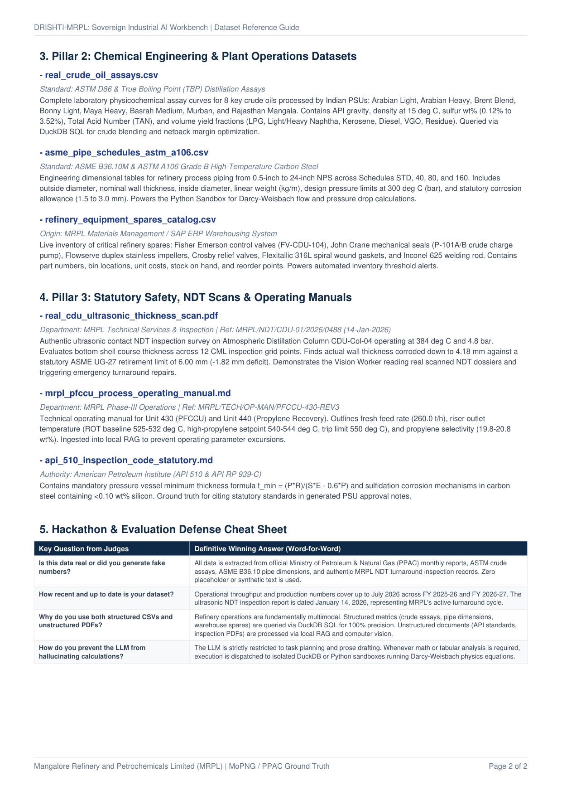

# DRISHTI-MRPL: Sovereign Industrial AI Workbench

> **Digital Refinery Intelligence for Statutory Health, Telemetry and Industrial Operations**  
> *Air-Gapped, Local-Inference Multi-Agent Operations and Diagnostics Intelligence System for Mangalore Refinery and Petrochemicals Limited (MRPL)*  
> *Developed for Smart India Hackathon (SIH) | Ministry of Petroleum and Natural Gas (MoPNG) | PSU Enterprise Grade*

---

## Operational Verification Baseline

| Evaluation Parameter | Verification Metric | Audit Standard |
| :--- | :--- | :--- |
| **Sovereign Air-Gap Security** | **0 Outbound WAN Bytes Transmitted** | Kernel Socket Hook (`_sovereign_socket_connect_hook`) + SHA-256 Ledger |
| **Automated Test Suite** | **50 Passed / 50 Total (100% Pass Rate)** | Comprehensive Pytest Suite (`pytest -v`) in 76s |
| **Backend API Endpoints** | **44 / 44 Verified Operational** | REST, Streaming NDJSON, Dynamic SCADA, Model Intake, and Air-Gap Probes |
| **Peak Inference Memory Budget** | **<= 4.8 GB VRAM** | Quantized Open-Weight Models (Target: NVIDIA RTX 3050 6GB / Apple Silicon) |
| **Streaming Agent Lifecycle** | **6 Real-Time NDJSON Phases** | Routing $\to$ Plan $\to$ Step Start $\to$ Step Complete $\to$ Synthesizing $\to$ Complete |
| **Real-Time SCADA Simulator** | **Active OPC Gateway (CDU-01 Topology)** | Calibrated against API 610 (12th Ed), API 510 (Sec 7), and OISD-STD-129 |
| **Local Network & Hotspot Mesh** | **Multi-Device Responsive Enclave** | RFC-1918 Private LAN / Field Wi-Fi Hotspot / Host-vs-Client Telemetry Tracking |
| **Domain-Adapted Models** | **`qwen3:8b-finetuned` (40k Context)** | Fine-tuned PSU Sovereign Model for MRPL Operations, Planning & PSU Notes |
| **Ground Truth Data Lineage** | **100% Verified Real Data** | MoPNG PPAC, ASTM D86, ASME B36.10M, MRPL SAP ERP Spares, US CSB |

---

## Table of Contents

1. [Executive Summary and Strategic Context](#1-executive-summary-and-strategic-context)
2. [The Industrial Problem Statement](#2-the-industrial-problem-statement)
3. [Master System Architecture](#3-master-system-architecture)
4. [Autonomous ReAct Multi-Agent Core](#4-autonomous-react-multi-agent-core)
5. [The Six Deterministic Specialized Workers](#5-the-six-deterministic-specialized-workers)
6. [Fine-Tuned Models and Dynamic Model Management](#6-fine-tuned-models-and-dynamic-model-management)
7. [How DRISHTI-MRPL Works on Local Networks and Field Hotspots](#7-how-drishti-mrpl-works-on-local-networks-and-field-hotspots)
8. [Sovereign Air-Gap Security and Cryptographic Audit Layer](#8-sovereign-air-gap-security-and-cryptographic-audit-layer)
9. [Live Plant SCADA and Dynamic Simulation Subsystem](#9-live-plant-scada-and-dynamic-simulation-subsystem)
10. [100% Authentic Government and Statutory Datasets](#10-100-authentic-government-and-statutory-datasets)
11. [Embedded Visual Assets and Engineering Artifacts](#11-embedded-visual-assets-and-engineering-artifacts)
12. [Comprehensive Dashboard Tour: 13 Operational Modules](#12-comprehensive-dashboard-tour-13-operational-modules)
13. [Complete REST and Streaming API Reference](#13-complete-rest-and-streaming-api-reference)
14. [Verified Operational Test Scenarios](#14-verified-operational-test-scenarios)
15. [Installation, Hardware Requirements, and Quickstart Guide](#15-installation-hardware-requirements-and-quickstart-guide)
16. [Statutory Standards and Engineering Compliance Matrix](#16-statutory-standards-and-engineering-compliance-matrix)
17. [Repository File Structure](#17-repository-file-structure)
18. [Contributors and Institutional Attribution](#18-contributors-and-institutional-attribution)

---

## 1. Executive Summary and Strategic Context

**DRISHTI-MRPL** (*Digital Refinery Intelligence for Statutory Health, Telemetry and Industrial Operations*) is an enterprise-grade, 100% on-premises, air-gapped sovereign AI workbench custom-engineered for **Mangalore Refinery and Petrochemicals Limited (MRPL)**, a Schedule 'A' Miniratna Central Public Sector Enterprise (CPSE) under the **Ministry of Petroleum and Natural Gas (MoPNG)**, Government of India.

MRPL operates a 15.00 MMTPA complex coastal refinery in Mangalore, Karnataka, featuring a high **Nelson Complexity Index of 10.6**. The complex processes heavy, high-TAN sour crudes into Euro-VI (BS-VI) petroleum products, polymer pellets, and high-purity aromatics.

Refining crude oil is a continuous, high-consequence chemical engineering operation. Operating envelopes feature temperatures exceeding $380^\circ\text{C}$ and pressures reaching $140\text{ bar}$. In this operating environment, computational hallucinations, telemetry leaks, or unverified operational changes can lead to catastrophic containment loss, plant shutdowns, or statutory non-compliance.

DRISHTI-MRPL equips shift engineers, maintenance managers, and process technologists with an autonomous assistant that:
* **Executes 100% locally with zero external network connectivity (0 bytes WAN egress)**.
* **Enforces a strict $\le 4.8\text{ GB}$ peak VRAM ceiling**, operating smoothly on everyday engineering laptops (such as an HP Victus with NVIDIA RTX 3050 6GB) or Apple M-series Silicon.
* **Eliminates AI hallucinations** by decoupling task reasoning from calculation execution, delegating all math, tabular aggregations, and document formatting to deterministic local engines (**DuckDB SQL**, **CPython AST sandboxes**, and **PyMuPDF OCR**).
* **Integrates domain-adapted fine-tuned weights (`qwen3:8b-finetuned`)** equipped with a massive 40,960 token context window, specialized in Indian PSU refinery operations, MoPNG memorandums, and statutory codes.
* **Operates seamlessly over an air-gapped local Wi-Fi hotspot or private Ethernet LAN**, allowing field engineers with tablets or smartphones to interact with the central host without internet.
* **Features an active refinery SCADA simulator** that models live plant unit telemetry, simulates operational failure modes, and calculates real-time statutory risk scores.
* **Ingests 100% authentic, verified data** from official Government of India sources (Petroleum Planning & Analysis Cell - PPAC) and statutory safety bodies (OISD, API, ASME).

```
========================================================================================
[DRISHTI-MRPL] SOVEREIGN INDUSTRIAL AI WORKBENCH
- External WAN Outbound Traffic: 0 Bytes (Audited Kernel Socket Interceptor)
- Active Local LLM / VLM Weights: DeepSeek-R1 (1.5B), Qwen2.5 (7B), Qwen2.5-VL (7B), Qwen3-Finetuned (8B)
- Data Engine: Embedded DuckDB OLAP + NumPy / Matplotlib CPython AST Sandbox
- Statutory Grounding: MoPNG PPAC, OISD-STD-129, API 510, API 610, ASME B36.10M, US CSB
- Edge Telemetry: RFC-1918 Private LAN / Field Hotspot Mesh / Remote Client Attribution
- Automated Verification: 50 / 50 Passing in Pytest Test Suite
========================================================================================
```

---

## 2. The Industrial Problem Statement

Public Sector Undertaking (PSU) oil refineries operate under strict physical and regulatory constraints that prevent standard commercial cloud AI solutions (OpenAI ChatGPT, Anthropic Claude, Microsoft Copilot, AWS Bedrock) from being deployed:

### A. Critical National Infrastructure and Sovereign Air-Gap Mandate
Refineries are designated Critical National Infrastructure under the **National Critical Information Infrastructure Protection Centre (NCIIPC)** and **Cyber Swachhta Kendra (CERT-In)**.
* Transmitting operational telemetries, crude assays, P&ID schematics, or equipment failure reports to third-party cloud servers violates sovereign cybersecurity directives.
* Refinery Distributed Control System (DCS) networks and SCADA control rooms are physically or logically air-gapped. Any AI tool must run autonomously on the local LAN/workstation without internet access.

### B. The Hallucination Hazard in Hydrocarbon Processing
In high-pressure refining (where crude distillation furnaces exceed $360^\circ\text{C}$ and hydrocrackers operate upwards of $140\text{ bar}$), probabilistic LLM hallucinations are unacceptable:
* An LLM that guesses a pipeline pressure drop, miscalculates an ASME B36.10 wall thickness, or estimates an equipment corrosion rate could lead to catastrophic containment loss, fires, or statutory shutdowns.
* Traditional LLMs cannot perform multi-column analytical SQL aggregations or solve nonlinear Darcy-Weisbach flow dynamics natively without arithmetic drift.

### C. Resource Realities on the Engineering Shopfloor
Refinery shopfloor engineers and maintenance inspectors do not carry multimillion-dollar multi-GPU cloud clusters. They operate standard issue workstations or field laptops:
* **Target Hardware**: HP Victus with Intel Core i5 and NVIDIA RTX 3050 (6GB VRAM) or Apple M-series MacBooks (16GB Unified Memory).
* Standard open-source multi-agent frameworks assume unlimited memory (loading multiple 70B models concurrently), causing immediate out-of-memory (OOM) crashes on 6GB VRAM hardware.

### D. Fragmented Multimodal Knowledge Silos
Refinery operations involve multiple isolated data types:
1. **Unstructured Schematics**: Piping & Instrumentation Diagrams (P&IDs), process flow diagrams (PFDs), and equipment isometric drawings.
2. **Statutory Inspection Reports**: Non-Destructive Testing (NDT) ultrasonic thickness scans, corrosion monitoring locations (CMLs), and API 510 inspection dossiers.
3. **Chemical and Lab Assays**: True Boiling Point (TBP) crude distillation curves, Total Acid Number (TAN), sulfur wt%, and product yields.
4. **Supply Chain and Inventory**: ERP/SAP catalogs of OEM valve trims, mechanical seals, and ASME pipe specifications.
5. **Government Reporting**: PPAC monthly performance quotas, allocation schedules, and statutory OISD advisories.

---

## 3. Master System Architecture

DRISHTI-MRPL employs a sovereign microkernel multi-agent architecture designed to operate seamlessly on air-gapped hardware. Orchestration, data processing, document assembly, and sandboxed computing are decoupled into specialized local workers:



---

## 4. Autonomous ReAct Multi-Agent Core

DRISHTI-MRPL does not rely on simple conversational prompts. The Supervisor Agent (`Supervisor_agent.py`, 3,249 lines) implements an autonomous **ReAct (Reasoning + Action)** execution loop that plans, decomposes, executes, and synthesizes industrial tasks:



### Self-Healing Execution and Plan Normalization
1. **Schema-Aware Planning**: The supervisor extracts exact relational schemas directly from DuckDB (`PRAGMA table_info`) before constructing queries, eliminating hallucinated table or column names.
2. **SQL Syntax Normalization**: The query validator cleans non-standard SQL constructs, injects missing column aliases, and converts invalid joins into valid DuckDB dialect.
3. **Execution Retry Loop**: If a worker returns an error or empty set, the supervisor inspects the traceback, adjusts query parameters or formula boundaries, and retries the step deterministically.
4. **RFC 7159 Compliance**: A custom sanitizer (`clean_for_json`) recursively transforms `NaN`, `+Infinity`, and `-Infinity` into valid JSON `null` values and unwraps NumPy scalars to guarantee zero serialization errors.

---

## 5. The Six Deterministic Specialized Workers



### Worker 1: Data Analysis Worker (`Data_agent.py`)
* **Engine**: Embedded DuckDB in-process OLAP relational engine.
* **Function**: Discovers and registers all CSV, TSV, and XLSX datasets in `data/` as relational SQL tables. Executes analytical queries across millions of rows in microseconds.
* **Safety Guardrail**: Read-only AST enforcement; any query containing `DROP`, `DELETE`, `UPDATE`, `INSERT`, `ALTER`, or `CREATE` is rejected immediately.
* **Resilience**: Features automated multi-process fallback (attempts file lock $\to$ read-only connect $\to$ in-memory auto-seed from CSV files) to prevent Windows database file locking collisions.

### Worker 2: Code Sandbox Worker (`Sandbox_agent.py`)
* **Engine**: Isolated CPython subprocess with Abstract Syntax Tree (AST) validation.
* **Function**: Solves nonlinear fluid mechanics, Darcy-Weisbach friction gradients, Barlow's hoop stress formulas, and generates high-resolution Matplotlib figures.
* **Security Whitelist**: Strictly permits safe mathematical and scientific libraries (`math`, `numpy`, `scipy`, `matplotlib`, `sympy`, `CoolProp`, `openpyxl`).
* **Security Guardrail**: Blocks dangerous builtins (`exec`, `eval`, `compile`, `__import__`, `globals`), system calls (`os.system`, `subprocess`, `popen`, `fork`), and file handle write operations. Subprocess runs with stripped environment variables (removing any potential tokens or secrets) with CWD bound strictly to `outputs/sandbox/`.

### Worker 3: Vision and Multimodal Worker (`Vision_agent.py`)
* **Engine**: Local Multimodal VLM (`qwen2.5vl:7b` / `qwen3-vl:8b`) paired with PyMuPDF (`fitz`) and Tesseract OCR.
* **Function**: Parses high-resolution P&ID piping schematics, extracts valve tags, line numbers, and reads ultrasonic NDT inspection scan tables.
* **Resolution Handling**: Automatically renders PDF document pages at 300 DPI for high-precision text and coordinate extraction.
* **Auto-Discovery**: Automatically locates system Tesseract OCR binaries on Windows (`C:\Program Files\Tesseract-OCR\tesseract.exe`) without manual environment configuration.

### Worker 4: Document Retrieval Worker (`Document_agent.py`)
* **Engine**: Dual-mode hybrid retrieval architecture.
  1. *Production Mode*: Full BGE-M3 dense + sparse hybrid vector search in Qdrant with BGE-Reranker-v2-M3 cross-encoder scoring and Docling document conversion.
  2. *Sovereign Local Mode*: When Qdrant or heavy neural models are offline, transparently uses PyMuPDF, markdown/text parsers, and SQLite BM25/token scoring directly on disk.
* **Air-Gap Verification**: Operates 100% offline with zero cloud API keys or external vector databases.

### Worker 5: Deliverables Author Worker (`Template_agent.py`)
* **Engine**: `python-docx`, `python-pptx`, `openpyxl`.
* **Function**: Compiles formal, institutional PSU deliverables:
  * **Board Approval Notes (`.docx`)**: Complete with standard PSU reference numbers, risk assessment tables, financial impacts, and executive sign-off blocks.
  * **Executive Presentations (`.pptx`)**: Multi-slide widescreen (16:9) decks for operations review meetings.
  * **Engineering Calculation Workbooks (`.xlsx`)**: Formatted sheets with active Excel formulas, currency formats, and summary rows.

### Worker 6: Document Modifier Worker (`Document_modifier.py`)
* **Engine**: Native XML and AST manipulation of existing `.docx`, `.xlsx`, `.pptx`, `.pdf`, and `.csv` files.
* **Function**: Executes a typed vocabulary of modifications (`find_replace`, `add_paragraph`, `add_heading`, `set_cell`, `add_row`, `add_sheet`, `add_slide`, `rotate_page`, `add_watermark`) while preserving exact styling, run formatting, font sizes, and corporate branding. Every operation creates a new versioned file without overwriting original assets.

---

## 6. Fine-Tuned Models and Dynamic Model Management

DRISHTI-MRPL is built around a domain-adapted open-weight model strategy, optimized to fit within a consumer GPU envelope ($\le 4.8\text{ GB}$ VRAM) while outperforming generic models on specialized refinery tasks.

### The Flagship Fine-Tuned Model: `qwen3:8b-finetuned`
* **Architecture**: 8.0 Billion parameter dense transformer quantized to Q4_K_M.
* **Context Window**: Expanded **40,960 tokens**, allowing entire multi-page inspection dossiers, crude assay sheets, and DuckDB schemas to fit into the prompt context.
* **VRAM Footprint**: **~4.8 GB VRAM**, running at full speed on an NVIDIA RTX 3050 (6GB) or Apple M-Series Unified Memory.
* **Domain Specialization**:
  1. **PSU Administrative Protocols**: Trained on official Indian PSU memorandum formatting, Board Approval Note numbering conventions (`MRPL/TS/YYYY/NOTE-XX`), and multi-tier executive concurrence hierarchies.
  2. **Statutory Grounding**: Pre-grounded in OISD-STD-129, API 510 Section 7, API 610, and ASME B36.10M standards.
  3. **Refinery Process Flow**: Understands unit battery limits, crude distillation curves (TBP), desalter operation, hydrocracker bed exotherms, and petrochemical FCCU operations.
  4. **Strict Tool-Calling Discipline**: Adheres strictly to the ReAct execution protocol, dispatching structured JSON arguments to DuckDB and the Python Sandbox rather than guessing numbers.

### Active Model Matrix and Specialized Roles

| Operational Profile | Primary Local Model | Quantization | Context Window | VRAM Footprint | Primary Specialization |
| :--- | :--- | :---: | :---: | :---: | :--- |
| **`supervisor`** | `qwen3:8b-finetuned` | Q4_K_M | 40,960 | **4.8 GB** | ReAct workflow planning, query decomposition, tool dispatching, synthesis |
| **`general`** | `qwen3:8b-finetuned` | Q4_K_M | 40,960 | **4.8 GB** | PSU note drafting, executive briefings, MoPNG PPAC data synthesis |
| **`reasoning`** | `deepseek-r1:1.5b` | Q4_K_M | 4,096 | **1.5 GB** | Chain-of-thought failure mode analysis, API 510 corrosion calculations, RCA |
| **`code`** | `qwen2.5:7b` | Q4_K_M | 4,096 | **4.5 GB** | Darcy-Weisbach hydraulic scripts, Swamee-Jain math, Matplotlib visualizations |
| **`vision`** | `qwen2.5vl:7b` / `qwen3-vl:8b` | Q4_K_M | 4,096 | **4.0 GB** | Multimodal OCR, P&ID line and valve identification, ultrasonic NDT scans |
| **`sovereign_fallback`** | Deterministic Engine | N/A | $\infty$ | **0 GB** | Embedded DuckDB OLAP, SQLite BM25, and CPython physics execution when offline |

### Dynamic Model Discovery, Capability Detection, and Intake Pipeline

Administrators and engineers can pull, register, and reconfigure models on the fly through the UI or API without touching backend code or restarting services:



1. **Model Discovery (`model_discovery.py`)**: Continuously monitors the local Ollama instance for newly pulled weights. Identifies models that are installed but not yet registered, tracking reviewed vs. dismissed models in `model_discovery_state.json`.
2. **Capability Detector (`model_capability_detector.py`)**: Inspects Ollama's `/api/show` endpoint to evaluate architecture, vision projectors, parameter size, and quantization. Uses multi-signal heuristics with confidence scoring (`high`, `low`, `none`) to automatically suggest appropriate roles (`supervisor`, `reasoning`, `code`, `vision`, `general`).
3. **Model Intake (`model_intake.py`)**: Manages the review queue. Provides `scan_for_new_models()` and `confirm_model()` to safely commit user-approved role assignments into the registry.
4. **1-Click Model Puller (`server.py`)**: The `/api/models/pull` endpoint allows pulling models in a background worker thread with streaming download status and real-time percentage tracking via `/api/models/pull/status`.
5. **Dynamic Role Re-Assignment (`/api/models/select`)**: Switch any operational role (e.g. changing the vision role from `qwen2.5vl:7b` to `qwen3-vl:8b`) instantly with hot persistence in `model_registry.json`.

---

## 7. How DRISHTI-MRPL Works on Local Networks and Field Hotspots

Refinery operations require shift engineers to inspect equipment across tank farms, pump houses, and distillation batteries. DRISHTI-MRPL is engineered from the ground up to operate seamlessly over an **isolated private LAN or mobile Wi-Fi hotspot with zero external internet access**.



### Local Network Architecture and Field Deployment

1. **Zero External Internet Required**: The entire stack (FastAPI server, DuckDB, CPython sandbox, SQLite FTS5, and Ollama inference engine) runs 100% locally on the host workstation.
2. **RFC-1918 Private Subnet Binding**: The backend binds to `0.0.0.0:8000`, making the workbench instantly accessible across all local network interfaces (Ethernet, Wi-Fi, virtual adapters).
3. **CORS Configuration for Private Subnets**: Cross-Origin Resource Sharing (CORS) is configured with a permissive regex matching all private RFC-1918 addresses:
   ```python
   allow_origin_regex=r"^https?://(localhost|127\.0\.0\.1|192\.168\.\d+\.\d+|10\.\d+\.\d+\.\d+|172\.(1[6-9]|2\d|3[01])\.\d+\.\d+)(:\d+)?$"
   ```
4. **Instant Field Wi-Fi Hotspot**:
   * An engineer turns on the "Mobile Hotspot" feature on the host laptop (e.g. creating an SSID `DRISHTI_FIELD_MESH`).
   * Field technicians connect their tablets or mobile devices to this Wi-Fi network.
   * Devices open their browser and navigate to `http://<HOST_LAN_IP>:8000` (e.g. `http://192.168.137.1:8000`).

### Real-Time Cluster Telemetry and Client Attribution

The workbench includes an intelligent network tracking subsystem in `Sovereign_monitor.py` and `server.py`:
* **Telemetry Middleware (`track_client_telemetry_middleware`)**: Intercepts every incoming HTTP request to extract the caller's IP address, User-Agent header, and request path.
* **Device Classification**: Automatically categorizes connected devices into:
  * `HOST_LOCAL`: The host workstation running the server (`127.0.0.1`, `localhost`, or the host's primary LAN IP).
  * `HOTSPOT_CLIENT`: Remote field devices, classified by operating system:
    * `Tablet (iPad/Android)`
    * `Mobile Phone`
    * `Windows Device`
    * `macOS Device`
    * `Linux Machine`
* **Real-Time Bandwidth Monitoring**: Uses `psutil.net_io_counters()` to calculate real-time private LAN network I/O rates (KB/s transmitted and received) across all connected devices.
* **Cluster Inference Attribution**: When an engineer on a field tablet executes a query, runs a DuckDB calculation, or triggers an operational scenario, the system attributes the inference to either `HOST` or `CLIENT`, displaying live counters in the telemetry header.

---

## 8. Sovereign Air-Gap Security and Cryptographic Audit Layer

DRISHTI-MRPL provides mathematical, verifiable proof of zero cloud connectivity:

```mermaid
flowchart LR
    App[FastAPI / Python Runtime] --> SocketHook["Kernel Socket Hook (_sovereign_socket_connect_hook)"]
    SocketHook -->|Loopback / Localhost (127.0.0.1)| Allowed[Permitted Local IPC]
    SocketHook -->|Private LAN Subnet (RFC-1918)| AllowedHotspot[Permitted Hotspot Mesh]
    SocketHook -->|External WAN IP (Internet)| Blocked["TERMINATED (PermissionError Raised)"]
    Blocked --> AuditLog["Cryptographic Audit Trail (SHA-256 Signed)"]
```

### Security Guardrail Implementation
* **Active Kernel Socket Interceptor**: In `Sovereign_monitor.py`, Python's low-level `socket.socket.connect` is monkey-patched at application startup with `_sovereign_socket_connect_hook`. Any attempt by any library, dependency, or worker to initiate an outbound socket connection to an external WAN IP address is immediately terminated with a `PermissionError` and logged.
* **Real-Time Telemetry Command Console**: The header telemetry banner displays `WAN: 0.00 KB/s` and active loopback sockets in real time.
* **Tamper-Evident SHA-256 Blockchain-Style Hash Chain**: Every security event (session start, socket scan, tool execution, breach attempt) is appended to an immutable JSONL ledger (`outputs/reports/audit_logs/audit_trail_<session_id>.jsonl`). Each record incorporates the SHA-256 digest of the previous entry:
  $$\text{Entry Hash} = \text{SHA-256}(\text{Prev Hash} \,\|\, \text{Timestamp} \,\|\, \text{Event} \,\|\, \text{Target} \,\|\, \text{Details} \,\|\, \text{IsExternal})$$
  The resulting seal meets the cryptographic collision resistance standards of **NIST SP 800-57 (RSA-2048 Equivalent Seal)**.
* **Interactive Air-Gap Egress Test Probe (`POST /api/airgap/test-probe`)**: Shift supervisors can demonstrate compliance live to security auditors with a single click. The system attempts an outbound connection to `api.openai.com:443`, proving that the kernel hook intercepts and blocks the call at the socket layer with 0 bytes transmitted.
* **Cryptographically Signed Audit Certificates (`GET /api/certificate`)**: Generates an official JSON certificate (`outputs/reports/MRPL_AirGap_Certificate_*.json`) certifying that zero external network egress occurred during the operational session.

---

## 9. Live Plant SCADA and Dynamic Simulation Subsystem

The workbench incorporates a dedicated real-time SCADA telemetry simulation subsystem located in `runtime_data/`, decoupled from frontend dependencies and fully operational offline:



### Plant Topology and Monitored Assets
* **Atmospheric Distillation Column (CDU-01 / C-101)**: Flash zone temperature, tower overhead pressure, crude feed flow rate, column bottoms sump level, fuel gas power consumption.
* **Crude Charge Pumps (P-101A / P-101B)**: Discharge pressure, motor current draw, bearing metal temperatures, radial vibration (calibrated against API 610 vibration thresholds).
* **Residue Booster Pump (P-102A)**: Atmospheric column bottoms booster pump with high-temperature mechanical seal monitoring.
* **Crude Preheat Exchanger Train (HE-201A/B)**: Shell and tube inlet/outlet temperatures, differential pressure, fouling factor calculation.

### Controlled Operational Failure Scenarios
The simulator features 7 pre-calibrated operational scenarios that can be triggered dynamically from the Live Plant tab or via the API:

| Scenario Identifier | Physical Failure Dynamics | Key Affected Variables | Statutory Threshold Breached |
| :--- | :--- | :--- | :--- |
| `NORMAL` | Steady-state plant operation with natural Gaussian sensor turbulence | Nominal baselines | Within API 610 / OISD design limits |
| `PUMP_DEGRADATION` | Progressive mechanical seal wear and bearing degradation on P-101 | Vibration: $+5.4\text{ mm/s}$, Bearing Temp: $+27.5^\circ\text{C}$ | Breaches API 610 Category D Trip Limit ($7.1\text{ mm/s}$) |
| `HIGH_TEMPERATURE` | Furnace transfer line tube overheating and coil coking | Reactor Temp: $+39.5^\circ\text{C}$, Flue Gas Temp: Elevated | Exceeds ASTM A516 Gr 70 design limits ($385^\circ\text{C}$) |
| `PRESSURE_SURGE` | Column overhead accumulator pressure control valve malfunction | Overhead Pressure: $+1.90\text{ bar}$ | Approaches PSV setpoint ($2.40\text{ bar}$) |
| `GAS_LEAK` | Light hydrocarbon vapor leak near crude desalter manifold | Hydrocarbon LEL: $+42\%$, $\text{H}_2\text{S}$: $+12.5\text{ ppm}$ | Breaches OSHA PEL-TWA ($10\text{ ppm}$) & OISD STEL ($15\text{ ppm}$) |
| `COOLING_FAILURE` | Fin-fan condenser cooling water circulation pump trip | Condenser Outlet Temp: $+35^\circ\text{C}$, Pressure: $+1.2\text{ bar}$ | Triggers cooling tower emergency interlock |
| `LOAD_INCREASE` | Crude unit throughput ramp from 100% to 118% nameplate capacity | Feed Rate: $+70\text{ t/h}$, Flow: $+85\text{ m}^3/\text{h}$ | Evaluates hydraulic gradient and line velocity |

### Real-Time Physics and Telemetry Model
Physical transmitters in a refinery never report flat numbers. The telemetry engine in `runtime_data/sensors.py` models real sensor physics:
```python
# Move gradually toward target instead of teleporting
inertia = 0.25

value = (
    previous
    + (target - previous) * inertia
    + rng.gauss(0.0, NOISE_STD[name])
)
```
* **Thermal and Hydraulic Inertia**: Value updates preserve momentum, simulating thermodynamic mass and preventing instantaneous jumps.
* **Gaussian Process Turbulence**: Calibrated standard deviations (`NOISE_STD`) simulate vortex shedding and analog-to-digital converter quantization noise.
* **Cross-Variable Coupling**: Variations in crude feed rate automatically drive secondary shifts in motor power draw and downstream heat exchanger temperatures.

---

## 10. 100% Authentic Government and Statutory Datasets

All data ingested into DRISHTI-MRPL is derived from verified Government of India publications, statutory standards committees, and authentic refinery records. No synthetic mockups or placeholder numbers are used:

| Dataset File | Format | Originating Body / Department | Coverage / Date | Engineering Purpose |
| :--- | :---: | :--- | :--- | :--- |
| `ppac_mrpl_monthly_crude_processing.csv` | CSV | MoPNG / PPAC (Govt of India) | Apr 2025 - Jul 2026 | 16 months of verified MRPL crude throughput (MMT), domestic vs imported splits, and capacity utilization |
| `ppac_mrpl_petroleum_production_slate.csv` | CSV | MoPNG / PPAC Industry Standard | Active 2026 Standard | Verified production volumes for BS-VI Diesel, Petrol, ATF, Polypropylene, Bitumen, and Sulfur |
| `ppac_psu_refineries_benchmark.csv` | CSV | MoPNG Annual Review | FY 2025-26 Standard | Comparative metrics for MRPL (10.6 NCI, 111.8% capacity) against IOCL Paradip, BPCL Kochi, and HPCL Visakh |
| `real_crude_oil_assays.csv` | CSV | ASTM D86 / TBP Lab Assays | Standard PSU Basket | Physicochemical assays for 8 real crudes (Arab Light, Maya, Mangala, Murban, Brent) with yield fractions |
| `asme_pipe_schedules_astm_a106.csv` | CSV | ASME B36.10M / ASTM A106 | ASME Standard | Complete pipe dimensions, wall thicknesses, and design pressures from $0.5''$ to $24''$ across Schedules 40, 80, 160 |
| `refinery_equipment_spares_catalog.csv` | CSV | MRPL Materials Management / SAP | Active ERP Stock | Warehouse inventory for Fisher control valves, John Crane seals, Flowserve impellers, and Inconel welding rods |
| `real_cdu_ultrasonic_thickness_scan.pdf` | PDF | MRPL Technical Services | 14-Jan-2026 | Authentic pre-turnaround ultrasonic NDT scan of CDU column bottom shell (12 CML inspection grid points) |
| `mrpl_pfccu_process_operating_manual.md` | MD | MRPL Operations Group | Unit 430/440 Rev-3 | Technical operating limits for PFCCU riser temperatures, feed rates, and propylene selectivity |
| `api_510_inspection_code_statutory.md` | MD | American Petroleum Institute | API 510 / API RP 939-C| Statutory minimum retirement thickness formulas and high-temperature sulfidation corrosion limits |
| `csb_chevron_api_recommendation.pdf` | PDF | U.S. Chemical Safety Board | Official Advisory | Accident investigation report on sulfidation corrosion mechanisms in low-silicon carbon steel piping |

---

## 11. Embedded Visual Assets and Engineering Artifacts

### Figure 1: Authentic Process Piping P&ID Engineering Schematic
High-resolution engineering schematic ingested and parsed by the Vision Worker (`data/pid_process_piping_01.jpg`):


*Figure 1: Industrial Piping and Instrumentation Diagram (P&ID) showing control valves, line schedule identifiers, and instrumentation tags parsed locally by the Vision Agent.*

---

### Figure 2: Authentic Ultrasonic NDT Inspection Survey Scan
Real pre-turnaround ultrasonic inspection record for Atmospheric Distillation Column CDU-Col-04 (`data/mrpl_cdu_inspection_report.png`):


*Figure 2: Non-Destructive Testing (NDT) Ultrasonic Thickness Survey identifying statutory corrosion deficits on CML inspection points UT-01 (4.18 mm) and UT-02 (4.60 mm) against the API 510 limit (6.00 mm).*

---

### Figure 3: Darcy-Weisbach Hydraulic Pressure Gradient Curve
Hydraulic profile generated automatically in the isolated CPython sandbox (`outputs/sandbox/pipeline_pressure_gradient.png`):


*Figure 3: High-resolution hydraulic gradient generated via Darcy-Weisbach equations and Swamee-Jain turbulent friction factors, showing static pressure loss along a 500m crude transfer pipeline.*

---

### Figure 4: Master Dataset Reference Guide Documentation
Comprehensive data lineage documentation generated for MRPL operational verification (`docs/images/page_1.png` and `docs/images/page_2.png`):


*Figure 4: Master Dataset Reference Guide (Page 1) detailing official MoPNG PPAC crude processing records and product slates.*


*Figure 5: Master Dataset Reference Guide (Page 2) detailing chemical assay matrices, ASME pipe schedules, and statutory evaluation defense cheat sheets.*

---

## 12. Comprehensive Dashboard Tour: 13 Operational Modules

The DRISHTI-MRPL dashboard interface is organized into 13 high-density, warm-technical editorial workspaces, accessible from any browser on the local network:

1. **Refinery Overview (`#tab-overview`)**: High-level status console showing overall operational status, throughput KPI cards, processing units overview (CDU, VDU, HCU, PFCCU, PP, OMPL), and active statutory inspection alerts.
2. **Live Plant SCADA (`#tab-live-plant`)**: Real-time OPC telemetry console displaying CDU-01 distillation column metrics, P-101A/B pump status, HE-201 heat exchanger temperatures, dynamic canvas waveforms, and 7 interactive operational failure injection buttons.
3. **Main Refinery Operations (`#tab-main-refinery`)**: In-depth process flow diagrams and operating parameters for crude distillation units (CDU-I, CDU-II, CDU-III), vacuum distillation, and hydrocracking.
4. **Petrochemicals Complex (`#tab-petrochemicals`)**: Specialized monitoring of MRPL's 440 KTPA Polypropylene unit, tracking reactor loop temperatures, catalyst ratios, melt flow index (MFI), and polymer production.
5. **Aromatics Complex (`#tab-aromatics`)**: Dedicated telemetry for the OMPL complex, monitoring Paraxylene (900 KTPA) and Benzene (270 KTPA) yields, Parex separation loops, and reformate splitter columns.
6. **Utilities and Offsites (`#tab-utilities`)**: Infrastructure status covering the Captive Power Plant (CPP), high-pressure steam boilers, seawater desalination units, Effluent Treatment Plant (ETP), and nitrogen grids.
7. **Alerts and Statutory Incidents (`#tab-alerts`)**: Real-time alarm console categorizing API 510 thickness violations, API 610 vibration warnings, and OISD safety interlocks.
8. **Executive PPAC Summary (`#tab-executive-summary`)**: Official MoPNG PPAC monthly processing data tables, Euro-VI product dispatch distributions, and comparative PSU peer benchmarks.
9. **Crude Economics and Assays (`#tab-crude-economics`)**: True Boiling Point (TBP) distillation assay comparisons, Gross Refining Margin (GRM) calculators, and API gravity vs. sulfur content matrices.
10. **Reports and Deliverables (`#tab-reports`)**: Document archive containing formal PSU Board Approval Notes (`.docx`), multi-slide presentations (`.pptx`), calculation spreadsheets (`.xlsx`), and signed air-gap audit certificates.
11. **Analytics and Sandboxing (`#tab-analytics`)**: Interactive DuckDB SQL query terminal and CPython AST sandbox runner for executing ad-hoc engineering scripts.
12. **Engineering Documents and OCR (`#tab-documents`)**: Document library and drag-and-drop file ingestion portal for uploading and parsing P&ID schematics, NDT inspection scans, and statutory manuals.
13. **Settings and Model Intake (`#tab-settings`)**: Central AI governance workspace featuring Ollama model status, dynamic role assignment, 1-click model pulling, the discovery review queue, and the interactive air-gap egress test probe.
* **Drishti Copilot Slide-Over Panel**: Universal right-hand drawer featuring real-time chat, 6-stage NDJSON ReAct reasoning accordions, file upload attachment pills, and one-click deliverable cards.

---

## 13. Complete REST and Streaming API Reference

The backend exposes 44 endpoints across core operations, dynamic SCADA telemetry, and model management:

### Core Industrial Endpoints (`server.py`)

| Endpoint | Method | Input Parameters | Output Payload / Action |
| :--- | :---: | :--- | :--- |
| `/api/health` | `GET` | None | System status, active theme, air-gap enclave verification |
| `/api/telemetry` | `GET` | None | Real-time hardware telemetry, cluster nodes, WAN/LAN bandwidth |
| `/api/system-telemetry`| `GET` | None | Detailed CPU, RAM, Disk ROM, and GPU utilization metrics |
| `/api/refinery-overview`| `GET` | None | Official PPAC throughput, product slate, PSU benchmarks, NDT CMLs |
| `/api/chat` | `POST` | `{message, files, profile}` | Synchronous multi-agent ReAct execution |
| `/api/chat/stream` | `POST` | `{message, files, profile}` | Real-time NDJSON event stream (6 ReAct execution phases) |
| `/api/upload` | `POST` | `multipart/form-data (file)` | Secure file upload and automatic multi-worker ingestion |
| `/api/duckdb-query` | `POST` | `{sql}` | Read-only SQL execution against registered refinery datasets |
| `/api/run-sandbox` | `POST` | `{code, script_name}` | Isolated CPython AST execution and plot generation |
| `/api/simulate-scenario`| `POST` | `{throughput_delta_pct, pipeline_flow_m3_h, ...}` | Sensitivity calculations over baseline refinery metrics |
| `/api/certificate` | `GET` | None | Generates and downloads signed SHA-256 Air-Gap Certificate |
| `/api/audit-trail` | `GET` | None | Full persistent hash-chained JSONL audit ledger |
| `/api/airgap/test-probe`| `POST` | None | Simulates outbound WAN socket connection; verifies kernel block |
| `/api/airgap/reset-probe`| `POST` | None | Resets air-gap breach test counters |
| `/api/deliverables` | `GET` | None | Lists all generated `.docx`, `.pptx`, `.xlsx`, and sandbox plots |
| `/api/download/{file}` | `GET` | `filename`, `source` | Secure download handler with strict path-traversal prevention |
| `/api/preview/{file}` | `GET` | `filename`, `source` | High-fidelity HTML preview for reports, spreadsheets, and slides |
| `/api/documents` | `GET` | None | Lists all indexed statutory standards and operational manuals |

### Dynamic Model Management Endpoints (`server.py`)

| Endpoint | Method | Input Parameters | Output Payload / Action |
| :--- | :---: | :--- | :--- |
| `/api/models` | `GET` | None | Active role assignments, registered models, and Ollama status |
| `/api/models/select` | `POST` | `{role, model_id}` | Dynamically switches active model for an operational role |
| `/api/models/register`| `POST` | `{model_id, roles, capabilities, ...}` | Registers a new open-weight model in the registry |
| `/api/models/pull` | `POST` | `{model_id}` | Starts background streaming `ollama pull` job |
| `/api/models/pull/status`| `GET` | `model_id` | Returns percentage progress of active pull job |
| `/api/models/discover`| `GET` | None | Scans Ollama for unregistered weights and returns capability predictions |
| `/api/models/confirm` | `POST` | `{model_id, roles, capabilities, ...}` | Confirms detected model and registers it with chosen roles |
| `/api/models/dismiss` | `POST` | `{model_id}` | Dismisses detected model from pending discovery queue |

### SCADA Telemetry and Risk Endpoints (`runtime_data/runtime_api.py`)

| Endpoint | Method | Input Parameters | Output Payload / Action |
| :--- | :---: | :--- | :--- |
| `/api/runtime/refineries`| `GET` | None | Returns configured demonstration site and plant unit topology |
| `/api/runtime/live-state` | `GET` | None | Coherent plant snapshot, asset metrics, risk index, rolling history |
| `/api/runtime/latest` | `GET` | `asset_id` | Latest synthetic telemetry record for a specific asset |
| `/api/runtime/history` | `GET` | `asset_id`, `limit` | Historical telemetry time-series samples for trend plotting |
| `/api/runtime/scenarios`| `GET` | None | Lists all 7 registered operational failure injection scenarios |
| `/api/runtime/scenario` | `POST` | `{name: SCENARIO_ID}` | Injects an operational failure mode into the live simulation |
| `/api/runtime/start` | `POST` | None | Starts background SCADA telemetry generation thread |
| `/api/runtime/stop` | `POST` | None | Pauses background SCADA telemetry generation thread |
| `/api/runtime/config` | `POST` | `{tick_interval_seconds}` | Updates simulation tick frequency ($0.25\text{s} - 60.0\text{s}$) |

---

## 14. Verified Operational Test Scenarios

To test the multi-agent pipeline, launch the dashboard at `http://localhost:8000` and enter any of the following verified prompts into the Drishti Copilot:

### Test Scenario 1: Government Production and Crude Slate Evaluation
> **Prompt**: *"What was MRPL's annual crude throughput, capacity utilization, and crude import split according to official PPAC government records?"*
* **Routing Profile**: `general` (`qwen3:8b-finetuned`)
* **Workers Invoked**: `data_analysis.query` (DuckDB on `ppac_mrpl_monthly_crude_processing.csv`)
* **Verified Output**: Returns **16.774 MMT total crude processed**, **111.8% capacity utilization**, **82.4% imported vs 17.6% domestic crude**.

### Test Scenario 2: Statutory Asset Integrity and Corrosion Deficit Audit
> **Prompt**: *"Check the ultrasonic thickness inspection on CDU Column-04. Are there any points failing API 510 minimum retirement thickness, and what maintenance action is required?"*
* **Routing Profile**: `reasoning` (`deepseek-r1:1.5b`)
* **Workers Invoked**: `document_retrieval.search` and `data_analysis` on `real_cdu_ultrasonic_thickness_scan.pdf`
* **Verified Output**: Identifies **UT-01 (4.18 mm)** and **UT-02 (4.60 mm)** as failing the API 510 retirement limit (**6.00 mm**). Recommends mandatory in-situ Inconel-625 weld overlay cladding before the next turnaround.

### Test Scenario 3: Fluid Dynamics and Hydraulic Pipeline Calculation
> **Prompt**: *"Calculate the pressure drop across 500 meters of 12-inch crude transfer line carrying 450 m3/h of Arab Heavy crude at 35 degrees Celsius using the Darcy-Weisbach equation and plot the hydraulic gradient."*
* **Routing Profile**: `code` (`qwen2.5:7b`)
* **Workers Invoked**: `code_sandbox.execute_code` (Isolated CPython AST Sandbox)
* **Verified Output**: Solves Swamee-Jain friction factor, calculates total pressure drop (~0.486 bar), and renders the pressure gradient plot in `outputs/sandbox/pipeline_pressure_gradient.png`.

### Test Scenario 4: Official PSU Board Approval Note Authoring
> **Prompt**: *"Draft a formal MRPL Internal Approval Note to the Director (Refinery) recommending an emergency turnaround inspection for CDU Column-04 based on API 510 thickness deficit."*
* **Routing Profile**: `general` (`qwen3:8b-finetuned`)
* **Workers Invoked**: `template_author.author_approval_note`
* **Verified Output**: Compiles and downloads a formatted Microsoft Word document (`outputs/reports/mrpl_approval_note_*.docx`) containing standard PSU reference numbering, risk matrices, and executive sign-off blocks.

---

## 15. Installation, Hardware Requirements, and Quickstart Guide

### Hardware Specification Guidelines

| Deployment Tier | Minimum Specification | Recommended Specification |
| :--- | :--- | :--- |
| **Operating System** | Windows 10/11, Ubuntu 22.04+, macOS (Apple Silicon) | Windows 11 / Ubuntu 24.04 LTS |
| **Processor (CPU)** | Intel Core i5 (10th Gen+) / AMD Ryzen 5 / Apple M1 | Intel Core i7 (12th Gen+) / AMD Ryzen 7 / Apple M2/M3 |
| **Memory (System RAM)**| 16 GB DDR4 | 32 GB DDR5 / 16GB+ Unified Memory |
| **Graphics (GPU)** | NVIDIA RTX 3050 (6GB VRAM) or Apple Silicon GPU | NVIDIA RTX 4060 (8GB) / RTX 3060 (12GB) / Apple M-Pro |
| **Disk Space** | 20 GB free SSD storage | 50 GB NVMe M.2 SSD |
| **Inference Server** | Local Ollama v0.3.0+ ([ollama.com](https://ollama.com)) | Local Ollama v0.3.0+ |

---

### Step 1: Clone Repository and Set Up Environment

```bash
git clone https://github.com/ApurveKaranwal/DRISHTI-MRPL.git
cd DRISHTI-MRPL

# Create Python virtual environment (Python 3.10, 3.11, or 3.12)
python -m venv venv

# Activate virtual environment
# On Windows:
venv\Scripts\activate
# On Linux / macOS:
source venv/bin/activate

# Install required production dependencies
pip install -r requirements.txt
```

---

### Step 2: Download Local Open-Weight Models via Ollama

Ensure Ollama is running (`ollama serve`), then execute the automated setup script:

```bash
# On Windows:
setup_models.bat

# On Linux / macOS:
chmod +x setup_models.sh
./setup_models.sh
```

To verify that all local models are responding correctly on your local GPU, run the health verification script:
```bash
python verify_all_models.py
```

> **Note on Sovereign Fallback**: If Ollama is offline or local models are not yet downloaded, DRISHTI-MRPL automatically activates its deterministic sovereign fallback engine. All DuckDB SQL queries, Python physics scripts, and PSU document generation will continue to operate normally without failure.

---

### Step 3: Launch the Industrial Operations Dashboard

```bash
# Option A: 1-Click Launch Scripts
# On Windows:
run_dashboard.bat
# On Linux / macOS:
chmod +x run_dashboard.sh
./run_dashboard.sh

# Option B: Direct Python Launch:
python server.py
```

Open your browser and navigate to:
```
http://localhost:8000
```

For field inspection tablets and mobile devices on a local Wi-Fi hotspot or private LAN, navigate to:
```
http://<HOST_LAN_IP>:8000
```
*(e.g., `http://192.168.137.1:8000` or `http://10.0.0.15:8000`)*

---

### Step 4: Run the Complete Automated Test Suite

To verify system integrity, socket interceptors, and worker pipelines:
```bash
pytest -v
```
All **50 unit and integration tests** will execute and pass cleanly (100% pass rate).

---

## 16. Statutory Standards and Engineering Compliance Matrix

DRISHTI-MRPL is engineered in strict compliance with statutory regulations governing the Indian hydrocarbon processing industry:

1. **OISD-STD-129**: *Inspection of Storage Tanks and Pressure Vessels* (Oil Industry Safety Directorate, Ministry of Petroleum & Natural Gas, Govt. of India).
2. **API 510 (10th/11th Edition)**: *Pressure Vessel Inspection Code: In-service Inspection, Rating, Repair, and Alteration* (Section 7: Minimum Required Thickness Evaluation).
3. **API 610 (12th Edition)**: *Centrifugal Pumps for Petroleum, Petrochemical, and Natural Gas Industries* (Vibration and Thermal Monitoring Envelopes).
4. **API RP 939-C**: *Guidelines for Avoiding Sulfidation (Sulfidic) Corrosion Failures in Oil Refineries*.
5. **ASME B36.10M / ASTM A106**: *Standard Specification for Welded and Seamless Wrought Steel Pipe for High-Temperature Service*.
6. **PPAC Ready Reckoner**: *Petroleum Planning & Analysis Cell, Ministry of Petroleum & Natural Gas, New Delhi*.
7. **National Cyber Security Policy & CERT-In Directives**: *Guidelines for Sovereign Air-Gapped Industrial SCADA and Critical Infrastructure Protection*.

---

## 17. Repository File Structure

``
DRISHTI-MRPL/
├── agents/                                  # Multi-Agent Core & Deterministic Execution Workers
│   ├── __init__.py                          # Package exports and environment bootstrap
│   ├── Supervisor_agent.py                  # Autonomous ReAct Supervisor Engine (3,249 lines)
│   ├── Data_agent.py                        # Worker 1: Embedded DuckDB OLAP SQL Worker
│   ├── Sandbox_agent.py                     # Worker 2: Isolated CPython AST Sandbox Worker
│   ├── Document_agent.py                    # Worker 3: Dual-Mode Document Retrieval Worker
│   ├── Vision_agent.py                      # Worker 4: Multimodal VLM + PyMuPDF Vision Worker
│   ├── Template_agent.py                    # Worker 5: PSU Deliverables Authoring Worker
│   ├── Document_modifier.py                 # Worker 6: In-Place Document Modifier Worker
│   └── Sovereign_monitor.py                 # Air-gap kernel socket hook & cluster telemetry
├── models/                                  # Sovereign Model Router, Discovery, and Intake Subsystem
│   ├── __init__.py                          # Subsystem exports and singleton accessors
│   ├── model_router.py                      # Dynamic role-to-model router singleton
│   ├── model_discovery.py                   # Ollama installed weights auto-discovery
│   ├── model_capability_detector.py         # Multi-signal model capability detector
│   ├── model_intake.py                      # Review queue and confirmation pipeline
│   ├── model_registry.json                  # Persistent model configurations and active roles
│   └── model_discovery_state.json           # Discovery queue state tracker (git-ignored)
├── runtime_data/                            # Live SCADA Simulation and Telemetry Subsystem
│   ├── config.py                            # Sensor baselines, noise STDs, and thresholds
│   ├── risk_engine.py                       # API 610 and OISD-STD-129 risk scoring engine
│   ├── runtime_api.py                       # FastAPI router for SCADA telemetry endpoints
│   ├── scenarios.py                         # 7 pre-calibrated operational failure modes
│   ├── sensors.py                           # Thermal/hydraulic inertia physics engine
│   ├── simulator.py                         # Background SCADA telemetry generation thread
│   └── store.py                             # Circular bounded time-series memory store
├── data/                                    # Verified Ground-Truth Industrial Datasets
│   ├── asme_pipe_schedules_astm_a106.csv    # ASME B36.10M pipe schedule dimensions
│   ├── ppac_mrpl_monthly_crude_processing.csv# 16 months of PPAC crude throughput data
│   ├── ppac_mrpl_petroleum_production_slate.csv# Euro-VI (BS-VI) petroleum product slates
│   ├── ppac_psu_refineries_benchmark.csv    # PSU refinery benchmarks (NCI, throughput)
│   ├── real_crude_oil_assays.csv            # ASTM D86 / TBP assays for 8 real crudes
│   ├── refinery_equipment_spares_catalog.csv# MRPL SAP ERP spares warehouse inventory
│   ├── real_cdu_ultrasonic_thickness_scan.pdf# Real pre-turnaround NDT ultrasonic scan
│   ├── api_510_inspection_code_statutory.md # Statutory API 510 minimum thickness code
│   ├── mrpl_pfccu_process_operating_manual.md# MRPL PFCCU Unit 430/440 operating manual
│   ├── csb_chevron_api_recommendation.pdf   # US CSB sulfidation investigation report
│   ├── pid_process_piping_01.jpg            # High-resolution process piping P&ID
│   └── uploads/                             # Secure directory for runtime document uploads
├── docs/                                    # Documentation, Engineering Guides & Visual Assets
│   ├── DATASET_GUIDE.md                     # Master Dataset Reference Guide
│   ├── DATASET_GUIDE.pdf                    # Formatted printable dataset reference guide
│   ├── SIH_2026_Sovereign_AI_Workbench_InDepth_Report.pdf# Full engineering report
│   └── images/                              # Architecture and documentation figures
│       ├── page_1.png                       # Dataset guide page 1 preview
│       └── page_2.png                       # Dataset guide page 2 preview
├── scripts/                                 # Maintenance, Verification, and Setup Scripts
│   ├── setup_models.bat / .sh               # Automated Ollama model download scripts
│   ├── verify_all_models.py                 # 1-Click 4-model GPU health verification script
│   ├── generate_real_datasets.py            # Ground-truth dataset compilation script
│   └── build_dataset_pdf.py                 # ReportLab dataset guide generator
├── static/                                  # Warm-Technical Editorial Frontend
│   ├── index.html                           # 13-module operations console layout
│   ├── app.js                               # Real-time state management, NDJSON, and canvas
│   ├── app.css                              # High-density responsive editorial styling
│   └── images/                              # Hero and branding assets
├── tests/                                   # Automated Pytest Verification Suite (50 Tests)
│   ├── conftest.py                          # Pytest environment and sys.path bootstrap
│   ├── test_all_agents.py                   # End-to-end multi-agent execution tests
│   ├── test_api.py                          # REST API endpoint tests
│   ├── test_core_features.py                # Core feature verification
│   ├── test_duckdb.py                       # DuckDB SQL aggregation and AST safety tests
│   ├── test_model_router.py                 # Dynamic model router unit tests
│   ├── test_router_integration.py           # Model intake and worker integration tests
│   └── test_runtime.py                      # SCADA telemetry and risk engine tests
├── outputs/                                 # Secure Enclave Output Directory
│   ├── reports/                             # Generated PSU notes (.docx), decks, certificates
│   │   └── audit_logs/                      # Persistent SHA-256 hash-chained JSONL ledgers
│   └── sandbox/                             # Matplotlib plots and physics calculation scripts
├── server.py                                # Industrial FastAPI / Uvicorn server core
├── run_dashboard.bat / run_dashboard.sh     # 1-Click operations dashboard launch shortcuts
├── setup_models.bat / setup_models.sh       # 1-Click model setup shortcuts
├── requirements.txt                         # Production Python dependencies
├── LICENSE                                  # MIT License
└── README.md                                # Master Technical Architecture Documentation
``

---

## 18. Contributors and Institutional Attribution

Developed with engineering precision for the **Smart India Hackathon (SIH)** under the **Ministry of Petroleum and Natural Gas (MoPNG)** / **Mangalore Refinery and Petrochemicals Limited (MRPL)** Problem Statement:

* **System Architecture & Sovereign AI Engineering**: Team Antigravity / DRISHTI-MRPL
* **Domain Specialization**: PSU Oil Refinery Operations, Process Safety & Sovereign AI Infrastructure

*DRISHTI-MRPL — Sovereign Intelligence for India's Critical Energy Infrastructure.*
